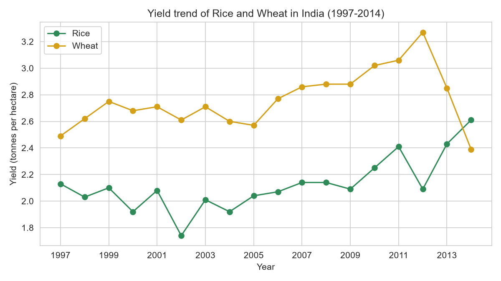
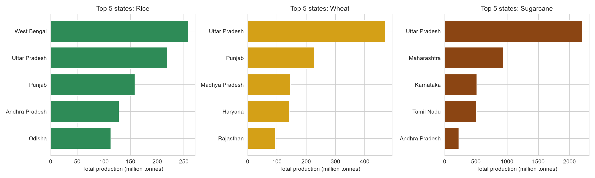
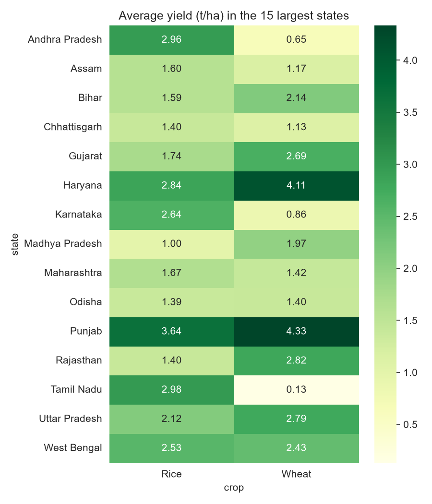
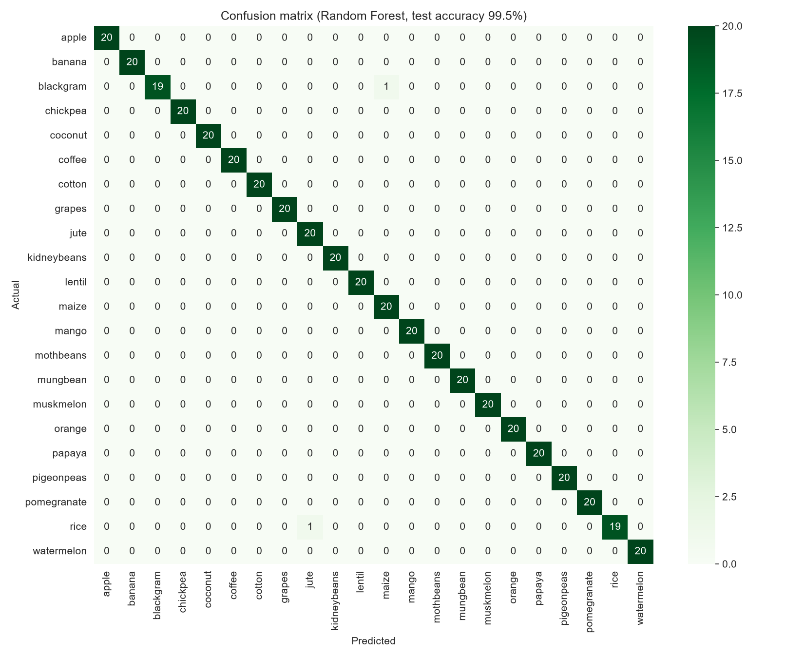

# 🌾 GreenIndia: Crop Analytics (Rice, Wheat, Sugarcane)

GreenIndia started in 2023 as a small crop-information website (HTML, CSS, PHP). I rebuilt it as an **end-to-end data analytics project**: real government crop data → SQL database → analysis → machine learning models → interactive dashboard.

The original website is still in the [`web_version`](web_version) folder. It now has the same green look as the dashboard, a static dashboard page, and a data insights section on every crop page.

## Questions this project answers
1. How did the **yield and production** of rice, wheat and sugarcane change across Indian states from 1997 to 2014?
2. Which states and seasons lead for each crop?
3. Which crop suits a given **soil and climate** (N, P, K, pH, temperature, humidity, rainfall)?
4. Can we **predict the yield** of a crop in a state for a season?

## Data
| Dataset | Rows | Source |
|---|---|---|
| District-wise crop production in India (area, production, season, 1997-2015) | 246,091 | Ministry of Agriculture & Farmers Welfare (data.gov.in), via Kaggle "Crop Production in India" |
| Crop Recommendation (N, P, K, temperature, humidity, pH, rainfall → crop) | 2,200 | Kaggle "Crop Recommendation Dataset" |

Both CSV files are in the `data` folder.

## Project structure
```
GreenIndia/
├── app.py                      Streamlit dashboard + prediction app
├── run_all.py                  runs the whole pipeline
├── requirements.txt
├── data/                       raw CSV files
├── sql/queries.sql             all SQL queries (window functions, CTEs, joins)
├── src/
│   ├── 01_build_database.py    cleaning + SQLite database
│   ├── 02_sql_analysis.py      runs the SQL queries, makes charts and tables
│   ├── 03_crop_recommender.py  crop recommendation model
│   └── 04_yield_model.py       yield prediction model
├── outputs/                    charts, tables (CSV, usable in Power BI / Tableau), reports
├── models/                     saved models (created by run_all.py)
└── web_version/                website (2023, restyled to match the dashboard)
```

## How to run
```bash
# 1. get the project
git clone https://github.com/022sourav/GreenIndia.git
cd GreenIndia

# 2. (optional) virtual environment
python -m venv venv
venv\Scripts\activate          # Windows
# source venv/bin/activate     # Mac / Linux

# 3. install libraries
pip install -r requirements.txt

# 4. run the full pipeline (about 1 minute): builds the database, charts and models
python run_all.py

# 5. start the app
streamlit run app.py
```
The app opens at http://localhost:8501. Python 3.9 or newer is needed.

## Website
Open `web_version/dashboard.html` in a browser (double-click it). It has the same sections as the Streamlit app (Dashboard, Crop Recommender, Yield Predictor, About) as static pages, and the crop pages (`rice.html`, `wheat.html`, `sugarcane.html`) show the analysis results for each crop next to the crop information. The "Open Live App" button opens the Streamlit app at http://localhost:8501, so start it first with `streamlit run app.py`.

The login and register pages (`web_version/PHP files`) need PHP and MySQL (for example XAMPP). They are not part of the data project.

## Method
**Cleaning** (`01_build_database.py`): kept Rice, Wheat and Sugarcane (30,924 rows); removed missing production, zero area or production, the incomplete year 2015 (only 123 rows), and the top 1% extreme yield values per crop (data entry errors, e.g. a yield of 88,000 t/ha). Final data: **30,338 rows, 33 states/UTs, 644 districts, 1997-2014**. Yield = production / area (tonnes per hectare). Details are saved in `outputs/cleaning_report.txt`.

**SQL analysis** (`sql/queries.sql`): yearly trends, top states with `RANK() OVER (PARTITION BY ...)`, state share of national production, season summary, and yield growth between 1998-2000 and 2012-2014 using CTEs and a join.

**Crop recommender**: compared Logistic Regression, KNN, Decision Tree and Random Forest with 5-fold cross validation, then tested the best one on a held-out 20% test set.

**Yield model**: predicts log(yield) from state, crop, season, year and area. It is trained on 1997-2010 and tested on 2011-2014 (a time-based split, so the test is like predicting the future). Compared with a simple baseline (average yield of the crop).

## Results
**Crop recommendation (22 crops)**

| Model | 5-fold CV accuracy |
|---|---|
| Logistic Regression | 96.8% |
| KNN | 96.6% |
| Decision Tree | 98.5% |
| **Random Forest** | **99.4%** |

Test accuracy of the Random Forest: **99.55%**. The most important features are rainfall, humidity and potassium (K), while pH matters least. See `outputs/charts/10_confusion_matrix.png`.

**Yield prediction (test years 2011-2014)**

| Model | MAE rice + wheat (t/ha) | R² (all crops) |
|---|---|---|
| Baseline (crop average) | 0.78 | 0.71 |
| Linear Regression | 0.64 | 0.81 |
| **Random Forest** | **0.55** | **0.89** |

The Random Forest reduces the rice and wheat error by about 30% compared with the baseline. R² for all crops is high mainly because sugarcane yield is so much larger than rice and wheat.

**Findings from the SQL analysis**
- Top producing states (cumulative 1997-2014): rice → West Bengal, Uttar Pradesh, Punjab; wheat → Uttar Pradesh, Punjab, Madhya Pradesh; sugarcane → Uttar Pradesh, Maharashtra, Karnataka.
- Highest average yield: Punjab for both rice (3.64 t/ha) and wheat (4.33 t/ha); Tamil Nadu for sugarcane (105.6 t/ha).
- National average yield rose from about 2.09 to 2.38 t/ha for rice and from 2.62 to 2.89 t/ha for wheat (average of 1997-99 vs 2011-14).
- Wheat is almost fully a Rabi crop; rice is mainly Kharif, and sugarcane is mostly a "Whole Year" crop.
- Haryana had the strongest rice yield growth among large producers (+37% between 1998-2000 and 2012-2014).

## Charts
| | |
|---|---|
|  |  |
|  |  |

## Limitations
- The production data ends in 2014, and the number of districts reporting is lower in the last years, so the drop of wheat yield in 2013-2014 may partly be a data coverage issue.
- Some very large yield changes (for example Chhattisgarh) are probably caused by state boundary changes in 2000 and not real farming changes.
- The yield model has no weather or soil inputs, because the production dataset does not contain them. The two datasets are separate: the recommender uses soil and climate measurements, the production data has no such measurements.
- The crop recommendation dataset looks very clean (99% accuracy is easy), so real-world accuracy would be lower.
- This is a learning project, not agronomic advice.

## Tools
Python, pandas, NumPy, SQL (SQLite), scikit-learn, matplotlib, seaborn, Streamlit

## Next steps
- Add rainfall and temperature data for each state and year to the yield model
- Build a Power BI / Tableau dashboard from the CSV files in `outputs/tables`
- Add price data to compare profit of different crops
